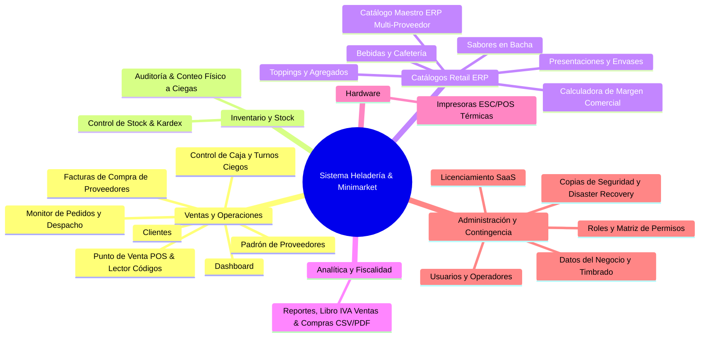

# Dossier de Módulos y Bondades del Sistema
### Sistema Integral de Gestión Retail ERP y Punto de Venta (POS) para Heladerías, Cafeterías y Minimarkets

---

## 1. Resumen Ejecutivo y Arquitectura

Este sistema es una solución empresarial de alta disponibilidad diseñada específicamente para resolver las complejidades operativas del sector gastronómico y de retail comercial (venta fraccionada por peso/potes, combinación de sabores, envases térmicos, toppings, productos de cafetería/minimarket, compras formales a distribuidores y liquidación fiscal), combinando agilidad en el punto de venta con estricto control de inventario, compras y caja.

### Stack Tecnológico:
* **Frontend:** Angular 19+ (Standalone Components, Signals reactivas, arquitectura modular, PWA instalable con modo pantalla completa / APK Kiosco).
* **Backend:** Java Spring Boot 3+, Spring Security con JWT, arquitectura RESTful y drivers directos de impresión ESC/POS.
* **Base de Datos:** PostgreSQL 16 Alpine con soporte transaccional ACID, kardex valorizado, auditorías físicas y catálogo maestro multi-proveedor (N:M).
* **Infraestructura:** Docker & Docker Compose con proxy inverso Nginx (soporte de subidas de hasta 100 MB) y certificados SSL integrados.

---

## 2. Catálogo Detallado de Módulos y sus Bondades

El sistema cuenta con **20 módulos funcionales** en el menú de navegación, organizados en **6 grandes áreas de negocio**:

---

### ÁREA 1: VENTAS, OPERACIONES Y COMPRAS

#### 1. Dashboard Principal (`/dashboard`)
* **Propósito:** Centro de comando visual con métricas clave en tiempo real.
* **Funcionalidades:**
  * Indicadores rápidos: total facturado hoy, cantidad de pedidos y ticket promedio.
  * Acceso directo al estado de la caja (abierta/cerrada) y alertas de reposición de stock.
* **Bondades para el Negocio:** Permite al dueño o encargado conocer la salud del negocio en los primeros 5 segundos del día sin tener que navegar reportes complejos.

#### 2. Control de Caja (`/caja`)
* **Propósito:** Gestión integral de turnos de cobro, ingresos, egresos y arqueos.
* **Funcionalidades:**
  * Apertura de turno con monto base.
  * Registro de movimientos de efectivo clasificados (gastos chicos, retiros, ingresos extras).
  * Arqueo con **cierre ciego de caja**: el cajero cuenta el dinero físico sin ver lo que el sistema calcula para evitar manipulaciones.
  * Historial auditable de todas las sesiones de caja con balance de faltantes o sobrantes.
* **Bondades para el Negocio:** **Elimina el robo hormiga y las pérdidas de dinero.** Cada centavo queda registrado y asociado al operador que abrió y cerró el turno.

#### 3. Punto de Venta - POS (`/pos`)
* **Propósito:** Terminal táctil ultra-rápida de ventas pensada para pantallas táctiles, tablets y computadoras de mostrador.
* **Funcionalidades:**
  * **Lector y Escáner de Código de Barras integrado:** Soporta pistolas lectoras USB/Bluetooth y teclado con tecla `Enter`. Al escanear un producto envasado o bebida, lo ingresa automáticamente al ticket de venta de manera instantánea.
  * Selección dinámica de presentaciones (potes de 1/4 kg, 1/2 kg, 1 kg, cucuruchos, vasitos).
  * Control del límite de sabores por presentación (ej.: máximo 3 gustos para 1/2 kg).
  * Agregado de toppings con precio diferencial.
  * Búsqueda ágil de clientes con validación de RUC paraguayo (Dígito Verificador DV).
  * Múltiples medios de pago: Efectivo, Tarjeta con carga de N° de Voucher y Billetera Digital/QR.
* **Bondades para el Negocio:** **Velocidad extrema de despacho en horas pico** (menos de 15 segundos por cliente), reduciendo filas de espera.

#### 4. Monitor de Pedidos (`/pedidos`)
* **Propósito:** Tablero de comandas estilo Kanban para el despacho en mostrador.
* **Funcionalidades:**
  * Estados del pedido: *Pendiente -> En Preparación -> Listo -> Entregado*.
  * Detalle exacto de cada orden: gustos elegidos, toppings, notas especiales y cliente.
  * Reimpresión rápida de tickets extraviados.
* **Bondades para el Negocio:** Sirve como pantalla de despacho o comanda para el personal que arma los helados, desacoplando al cajero del despachador y reduciendo la confusión de órdenes.

#### 5. Gestión de Clientes (`/clientes`)
* **Propósito:** Directorio y fidelización de la cartera de clientes.
* **Funcionalidades:**
  * Alta y edición con datos de facturación (RUC/CI con cálculo de DV, teléfono, correo y domicilio).
  * Historial de compras por cliente y búsqueda instantánea desde el POS durante la venta.
* **Bondades para el Negocio:** Construcción de base de datos para marketing, promociones de cumpleaños, delivery recurrente y facturación personalizada.

#### 6. Padrón y Gestión de Proveedores (`/proveedores`)
* **Propósito:** Registro integral de empresas proveedoras, distribuidores y mayoristas.
* **Funcionalidades:**
  * Alta y edición con RUC fiscal, razón social, persona de contacto/vendedor, teléfono, correo, depósito y cuentas bancarias.
  * **Trazabilidad Multi-Proveedor (N:M):** Badge interactivo con contador dinámico de artículos provistos.
  * **Modal de Artículos Suministrados:** Grilla detallada con artículos abastecidos, costos pactados individuales, precio de venta al público y marca de **⭐ Proveedor Principal**.
  * Conmutación de estado activo/inactivo.
* **Bondades para el Negocio:** Centraliza la agenda de compras y reposición, permitiendo saber al instante a qué distribuidor pedir cada bebida, insumo o envase al mejor costo pactado.

#### 7. Facturas de Compra & Ingreso a Stock (`/compras`) — *Nuevo*
* **Propósito:** Registro formal de facturas de compra de proveedores con triple impacto (ingreso a inventario, liquidación de Crédito Fiscal IVA y control financiero de pagos).
* **Funcionalidades:**
  * Carga obligatoria de datos fiscales: Proveedor, N° Factura, Timbrado, Fecha de Emisión, Fecha de Vencimiento y Condición (Contado / Crédito).
  * **Carga Rápida con Lector de Código de Barras**: Escaneo directo para inserción inmediata en la grilla.
  * **Carga Masiva en Bloque (Selección Múltiple)**: Grilla para marcar decenas de productos habituales con filtro **`⭐ Solo de este Proveedor`** e insertarlos en un solo paso.
  * **Alta Rápida de Artículos en Caliente (`+ ¿Artículo nuevo?`)**: Permite registrar un producto nuevo sin cerrar ni perder la compra en curso, utilizando la calculadora de margen para estimar el precio de venta e insertándolo al instante.
  * **Protección Total contra Cierre Accidental**: Fondo modal bloqueado y guardián de confirmación si el usuario intenta cancelar con datos cargados.
  * **Descargas Directas**: Botones en cabecera para exportar a **CSV (Excel)** y **PDF A4**.
* **Bondades para el Negocio:** Garantiza la actualización inmediata del stock real, computa el crédito fiscal de compras ante la SET/DNIT y previene errores humanos en la recepción de mercadería.

---

### ÁREA 2: CONTROL DE INVENTARIO Y STOCK

#### 8. Inventario & Stock (`/stock`)
* **Propósito:** Control centralizado de existencias de materias primas y productos de reventa.
* **Funcionalidades:**
  * Kardex detallado de movimientos (entradas por compra, salidas por venta, mermas).
  * Alertas automáticas de stock mínimo y crítico (notificaciones visuales en la barra superior).
  * Valorización monetaria del inventario a precio de costo y venta en Guaraníes.
* **Bondades para el Negocio:** **Evita el quiebre de stock** en momentos de alta demanda y ofrece una radiografía exacta del capital inmovilizado en mercadería.

#### 9. Auditoría & Conteo Físico a Ciegas (`/auditoria`)
* **Propósito:** Realización de tomas de inventario periódicas para contrastar stock real vs. stock teórico.
* **Funcionalidades:**
  * Conteo físico a ciegas (los auditores no ven el stock teórico para evitar cuadres artificiales).
  * Comparativa automática: *Stock en Sistema* vs. *Stock Contado* con cálculo de desviaciones.
  * Ajuste automático de stock documentado con motivo de diferencia (vencimiento, merma, rotura) y emisión del Acta Oficial en PDF A4 y CSV.
* **Bondades para el Negocio:** Detección temprana de fugas de mercadería, desvíos en el porcionado de helado y control sobre los inventarios de cierre de mes.

---

### ÁREA 3: CATÁLOGOS RETAIL ERP Y CALCULADORA DE PRECIOS

#### 10. Catálogo Maestro Retail ERP (`/catalogos/maestro`) — *Nuevo*
* **Propósito:** Administración centralizada de todo el universo de artículos del negocio.
* **Funcionalidades:**
  * Clasificación en 5 categorías: `VENTA_DIRECTA`, `ENVASE`, `SABOR`, `TOPPING`, `INSUMO`.
  * **Modelo Multi-Proveedor N:M:** Asociación de múltiples proveedores por artículo con costos individuales, códigos de referencia y proveedor principal ⭐.
  * **Calculadora Inteligente de Margen Comercial:** Tarjeta interactiva para calcular el Precio de Venta en tiempo real según el costo y margen deseado (**15%**, **20%**, **30%**, **50%**), con cálculo bidireccional y badge dinámico de ganancia neta.
* **Bondades para el Negocio:** Unifica el modelo comercial y productivo; permite negociar costos con distintos proveedores y asegura la rentabilidad operativa de cada artículo.

#### 11. Catálogo de Sabores (`/catalogos/sabores`)
* **Propósito:** Administración de la carta de gustos de helado en bacha.
* **Funcionalidades:** Alta de sabores, color identificador para POS y switch de disponibilidad instantáneo (apaga un gusto con 1 clic si se terminó en bacha sin borrarlo).
* **Bondades:** Reflejo inmediato en el POS: los cajeros nunca venderán un gusto que no esté disponible en la vitrina.

#### 12. Presentaciones y Potes (`/catalogos/presentaciones`)
* **Propósito:** Parametrización de envases térmicos, cucuruchos y formatos de venta.
* **Funcionalidades:** Configuración de precio, peso estimado en gramos y límite máximo de gustos permitidos (ej.: Cucurucho simple 1 gusto, Pote 1 kg 4 gustos).
* **Bondades:** Control estandarizado de porciones para garantizar el margen de rentabilidad de cada envase.

#### 13. Toppings y Agregados (`/catalogos/toppings`)
* **Propósito:** Gestión de salsas, coberturas y agregados dulces con precio adicional.
* **Bondades:** Monetización del *up-selling* (venta cruzada) aumentando el ticket promedio por cliente.

---

### ÁREA 4: ANALÍTICA, FISCALIDAD Y REPORTES

#### 14. Reportes Fiscales SET y Compras (`/reportes`) — *Actualizado*
* **Propósito:** Inteligencia de negocio, cumplimiento impositivo y auditoría.
* **Funcionalidades:**
  * **Nuevo Reporte de Compras a Proveedores:** Filtros por rango de fechas, proveedor, condición y estado. Tarjetas KPI de compras facturadas, crédito fiscal IVA total (10% y 5%) y pasivos a crédito.
  * **Exportación en CSV y PDF A4 Apaisado:** Descargas preparadas para Microsoft Excel (UTF-8 con BOM y delimitador `;`) e informes ejecutivos vectoriales.
  * **Libro de Ventas IVA:** Formato Hechauka/SET para liquidación impositiva mensual.
  * **Reporte de Cajas y Turnos:** Histórico de diferencias de caja y arqueos ciegos.
  * **Rankings de Ventas:** Artículos y gustos Top Sellers.
  * **Talonarios y Timbrados:** Alertas de vencimiento de comprobantes DNIT.
  * **Reimpresión de Comprobantes:** Búsqueda e impresión térmica histórica.
* **Bondades para el Negocio:** Decisiones basadas en datos reales y contabilidad al día sin trabajo manual extra.

---

### ÁREA 5: HARDWARE Y DISPOSITIVOS

#### 15. Impresoras ESC/POS (`/impresoras`)
* **Propósito:** Integración directa con impresoras térmicas de tickets y comandas.
* **Funcionalidades:** Soporte para impresoras térmicas USB, de Red (Ethernet/Wi-Fi) o Bluetooth; formatos de **58 mm** o **80 mm**; botón de diagnóstico de puerto/papel; apertura de cajón portamonedas.
* **Bondades para el Negocio:** Emite tickets fiscales y comandas directamente desde el backend sin requerir drivers complejos en cada estación.

---

### ÁREA 6: SEGURIDAD, ADMINISTRACIÓN Y CONTINGENCIA

#### 16. Usuarios y Operadores (`/usuarios`)
* **Propósito:** Gestión del personal que interactúa con el sistema.
* **Funcionalidades:** Alta de usuarios, asignación de roles, bloqueo de acceso inmediato y cambio obligatorio de contraseña en el primer inicio de sesión.
* **Bondades:** Trazabilidad completa: cada venta, compra o arqueo tiene nombre y apellido.

#### 17. Roles y Permisos (`/roles`)
* **Propósito:** Control de acceso granular basado en roles (RBAC).
* **Funcionalidades:** Creación de roles personalizados y matriz de permisos por módulo; roles de sistema protegidos (`ADMIN` y `OWNER`).
* **Bondades:** Protege la información confidencial de costos, reportes de facturación y configuraciones contra empleados no autorizados.

#### 18. Licenciamiento & Planes (`/licencia`)
* **Propósito:** Motor de activación y validación de licencias comerciales SaaS.
* **Funcionalidades:** Validación de clave criptográfica con fecha de caducidad y módulos autorizados (Básico, Estándar, Premium).
* **Bondades:** Convierte el sistema en un producto comercial listo para cobrar suscripción mensual (SaaS) o pagos anuales.

#### 19. Datos del Negocio y Timbrado (`/institucion`)
* **Propósito:** Identidad de marca y configuración fiscal legal.
* **Funcionalidades:** Carga de logotipo institucional, Razón Social, RUC con DV, número de Timbrado DNIT y fechas de vigencia.
* **Bondades:** Emisión de comprobantes legales con la imagen corporativa del negocio.

#### 20. Copias de Seguridad y Disaster Recovery (`/backup`) — *Actualizado*
* **Propósito:** Resguardo de datos y plan de contingencia ante fallas de hardware.
* **Funcionalidades:**
  * Generación de respaldo binario completo (`pg_dump -Fc` formato `.dump` comprimido) con 1 clic.
  * Descarga automática inmediata al equipo local.
  * **Zona de Restauración Drag & Drop**: Subida directa del archivo `.dump` desde el navegador (soporta hasta 100 MB).
  * **Recuperación ante Desastres (Disaster Recovery)**: Capacidad de reconstrucción total del sistema desde cero tras el borrado de volúmenes Docker.
* **Bondades:** Tranquilidad total para el propietario; ante cualquier siniestro o reemplazo de máquina, el sistema se restablece al 100% en menos de 3 minutos.

---

## 3. Bondades Técnicas Transversales (Diferenciadores Clave)

| Característica | Beneficio Técnico | Impacto Comercial |
|---|---|---|
| **Operación en Red Local (Sin Internet)** | Funciona 100% sobre Docker local o servidor interno en red LAN. | Si la heladería se queda sin servicio de internet, las cajas **siguen vendiendo e imprimiendo** con normalidad. |
| **PWA Pantalla Completa (Modo APK)** | Instalable en Android, Windows o tablets con selector de pantalla completa inmersiva. | No requiere pagar comisiones a tiendas de apps; se instala en tablets de mostrador como una app nativa. |
| **Diseño Responsive y Táctil** | Interfaz optimizada con botones de gran tamaño y contrastes de color pensados para pantallas táctiles. | Disminuye los errores de digitación de los operadores en el mostrador. |
| **Lector de Códigos de Barras** | Integrado en POS y en Facturas de Compra de proveedores. | Agiliza cobros y recepciones masivas de mercadería. |
| **Seguridad de Nivel Empresarial** | Contraseñas con hashing BCrypt, tokens JWT con expiración, y validación estricta de permisos tanto en front como en back. | Cumple con los estándares modernos de seguridad y auditoría de software. |

---

## 4. Guía de Monetización Sugerida

Para comercializar este sistema se sugieren tres esquemas:

### Esquema A: Suscripción Mensual (SaaS) — *Recomendado*
* **Plan Básico ($35 - $50 USD/mes):** POS, Caja, Clientes, Catálogos e Impresoras (hasta 2 usuarios).
* **Plan Profesional ($70 - $100 USD/mes):** Todo lo anterior + Inventario/Kardex, Auditoría de Stock, Facturas de Compra, Padrón de Proveedores, Reportes y Libro IVA (usuarios ilimitados).
* **Sucursal Adicional ($50 USD/mes c/u).**

### Esquema B: Licencia Perpetua (On-Premise / Servidor Local)
* **Licencia de por vida por local:** **$1.000 - $2.200 USD**.
* **Costo de instalación y puesta en marcha:** **$200 - $400 USD** (pago único inicial).
* **Abono de mantenimiento y soporte opcional:** **$40 - $60 USD/mes**.

### Esquema C: Venta del Código Fuente / Derechos
* **Venta llave en mano (Front + Back + BD + Docker):** **$8.000 - $18.000 USD**.
