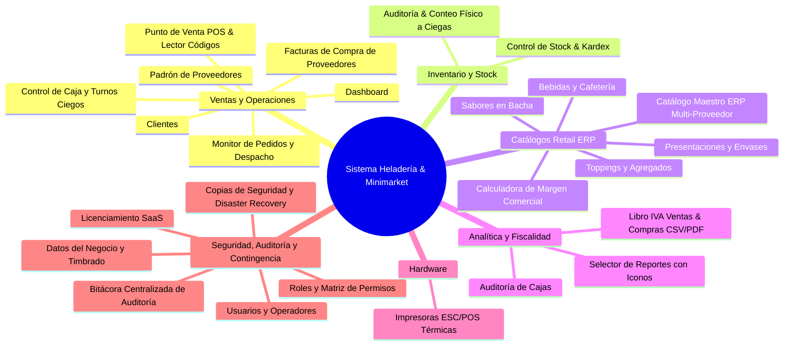

# Dossier de Módulos y Bondades del Sistema
### Sistema Integral de Gestión Retail ERP y Punto de Venta (POS) para Heladerías, Cafeterías y Minimarkets

---

## 1. Resumen Ejecutivo y Arquitectura

Este sistema es una solución empresarial de alta disponibilidad diseñada específicamente para resolver las complejidades operativas del sector gastronómico y de retail comercial (venta fraccionada por peso/potes, combinación de sabores, envases térmicos, toppings, productos de cafetería/minimarket, compras formales a distribuidores, liquidación fiscal y auditoría integral de cambios), combinando agilidad en el punto de venta con estricto control de inventario, compras, caja y trazabilidad total de usuarios.

### Stack Tecnológico:
* **Frontend:** Angular 19+ (Standalone Components, Signals reactivas, arquitectura modular, PWA instalable con modo pantalla completa / APK Kiosco).
* **Backend:** Java Spring Boot 3+, Spring Security con JWT, arquitectura RESTful y drivers directos de impresión ESC/POS.
* **Base de Datos:** PostgreSQL 16 Alpine con soporte transaccional ACID, kardex valorizado, auditorías físicas, catálogo maestro multi-proveedor (N:M) y bitácora de auditoría inmutable.
* **Infraestructura:** Docker & Docker Compose con proxy inverso Nginx (soporte de subidas de hasta 100 MB) y certificados SSL integrados.

---

## 2. Catálogo Detallado de Módulos y sus Bondades

El sistema cuenta con **21 módulos funcionales** en el menú de navegación, organizados en **6 grandes áreas de negocio**:

---

### ÁREA 1: VENTAS, OPERACIONES Y COMPRAS

#### 1. Dashboard Principal (`/dashboard`)
* **Propósito:** Centro de comando visual con métricas clave en tiempo real.
* **Funcionalidades:**
  * Indicadores rápidos: total facturado hoy, cantidad de pedidos y ticket promedio.
  * Acceso directo al estado de la caja (abierta/cerrada) y alertas de reposición de stock.
* **Bondades para el Negocio:** Permite al dueño o encargado conocer la salud del negocio en los primeros 5 segundos del día sin tener que navegar reportes complejos.

#### 2. Control de Caja (`/caja`)
* **Propósito:** Gestión integral de turnos de cobro, ingresos, egresos y arqueos.
* **Funcionalidades:**
  * Apertura de turno con monto base.
  * Registro de movimientos de efectivo clasificados (gastos chicos, retiros, ingresos extras).
  * Arqueo con **cierre ciego de caja**: el cajero cuenta el dinero físico sin ver lo que el sistema calcula para evitar manipulaciones.
  * Historial auditable de todas las sesiones de caja con balance de faltantes o sobrantes.
* **Bondades para el Negocio:** **Elimina el robo hormiga y las pérdidas de dinero.** Cada centavo queda registrado y asociado al operador que abrió y cerró el turno.

#### 3. Punto de Venta - POS (`/pos`) — *Actualizado*
* **Propósito:** Terminal táctil ultra-rápida de ventas pensada para pantallas táctiles, tablets y computadoras de mostrador.
* **Funcionalidades:**
  * **Buscador Multimodal Rápido (3 Opciones):**
    1. **Código de Barras:** Pistola lectora USB/Bluetooth o tecleado manual. Al escanear o presionar `Enter`, el artículo se agrega **automáticamente al ticket** de forma transparente.
    2. **Código de Producto / ID interno:** Para localizar rápidamente artículos codificados en bodega.
    3. **Nombre / Descripción:** Búsqueda incremental instantánea.
  * **Botón Rápido `+` en Artículos:** Permite sumar unidades de cualquier producto empaquetado o bebida con un solo toque directo.
  * Selección dinámica de presentaciones (potes de 1/4 kg, 1/2 kg, 1 kg, cucuruchos, vasitos) con bloqueo automático de bachas agotadas.
  * Control del límite de sabores por presentación y agregados de toppings con precio diferencial.
  * Búsqueda ágil de clientes con validación de RUC paraguayo (Dígito Verificador DV).
  * Múltiples medios de pago: Efectivo, Tarjeta con **ingreso obligatorio de N° de Voucher POS** y Billetera Digital/QR.
* **Bondades para el Negocio:** **Velocidad extrema de despacho en horas pico** (menos de 15 segundos por cliente), reduciendo filas de espera.

#### 4. Monitor de Pedidos (`/pedidos`)
* **Propósito:** Tablero de comandas estilo Kanban para el despacho en mostrador.
* **Funcionalidades:** Estados *Pendiente -> En Preparación -> Listo -> Entregado*, detalle de sabores y notas especiales.
* **Bondades para el Negocio:** Desacopla al cajero del despachador y reduce la confusión en horas pico.

#### 5. Gestión de Clientes (`/clientes`)
* **Propósito:** Directorio y fidelización de la cartera de clientes.
* **Funcionalidades:** Alta y edición con datos de facturación (RUC/CI con cálculo de DV Módulo 11) e historial de compras.

#### 6. Padrón de Proveedores (`/proveedores`)
* **Propósito:** Directorio comercial de distribuidores mayoristas.
* **Funcionalidades:** RUC con DV, datos bancarios para transferencias y modal interactivo para consultar todos los artículos provistos con costos pactados y proveedor principal ⭐.

#### 7. Facturas de Compra de Proveedores (`/compras`)
* **Propósito:** Registro formal de facturas de compra con respaldo fiscal.
* **Funcionalidades:** Carga rápida por código de barras, selección masiva en bloque, alta rápida de artículos en caliente (`+ ¿Artículo nuevo?`), protección contra cierre accidental, liquidación de Crédito Fiscal IVA y descargas en CSV y PDF A4.

---

### ÁREA 2: INVENTARIO, ALMACÉN Y STOCK

#### 8. Control de Stock & Kardex (`/stock`)
* **Propósito:** Control en tiempo real de existencias físicas y valor monetario del inventario.
* **Funcionalidades:** Alertas de stock crítico/mínimo, control fraccionado en kilogramos (`kg`) para helados y unidades (`u`) para envases/bebidas, registro de mermas y kardex cronológico.
* **Bondades:** Evita quiebres de stock en sabores estrella y transparenta los movimientos de almacén.

#### 9. Auditoría & Conteo Físico a Ciegas (`/auditoria`)
* **Propósito:** Toma de inventario físico sin ver las cantidades teóricas del sistema (*Blind Stocktaking*).
* **Funcionalidades:** Carga de cantidades contadas, aplicación atómica de ajustes, reactivación de sabores agotados con existencia positiva y emisión de Acta Oficial firmada en PDF A4 y CSV.
* **Bondades:** **Elimina la manipulación de números en auditorías físicas.**

---

### ÁREA 3: CATÁLOGOS RETAIL ERP

#### 10. Catálogo Maestro ERP Multi-Proveedor (`/catalogos/maestro`)
* **Propósito:** Gestión integral de la lista de artículos comerciales.
* **Funcionalidades:** Clasificación en 5 categorías (`VENTA_DIRECTA`, `ENVASE`, `SABOR`, `TOPPING`, `INSUMO`), asignación multi-proveedor N:M con costos individuales, proveedor principal ⭐ y **Calculadora Inteligente de Margen Comercial** (**15%**, **20%**, **30%**, **50%**).
* **Bondades:** Unifica el modelo comercial y productivo, asegurando la rentabilidad operativa.

#### 11. Catálogos de Sabores, Presentaciones y Toppings (`/catalogos/*`)
* **Propósito:** Parametrización de bachas, potes térmicos y agregados dulces con límites de porciones.

---

### ÁREA 4: ANALÍTICA, FISCALIDAD Y REPORTES

#### 12. Módulo de Reportes y Analítica con Selector de Iconos (`/reportes`) — *Actualizado*
* **Propósito:** Inteligencia de negocio, cumplimiento impositivo y auditoría.
* **Funcionalidades:**
  * **Nuevo Selector Desplegable con Iconos y Descripciones:** Navegación limpia e intuitiva entre los 9 reportes del sistema con íconos temáticos y descripciones funcionales.
  * **9 Reportes Integrados:**
    1. Dashboard Ejecutivo
    2. Ventas Detalladas
    3. Compras a Proveedores (Crédito Fiscal IVA)
    4. Libro Ventas IVA (SET / DNIT Hechauka)
    5. Auditoría de Cajas (arqueos y diferencias)
    6. Ranking Productos & Sabores
    7. Reimpresiones Térmicas
    8. Talonarios & Timbrado SET
    9. Inventario & Kardex Valorizado
  * **Exportaciones Oficiales:** Botones de cabecera para generar planillas en **CSV (Excel UTF-8 con BOM)** y **PDF A4 Apaisado** con membrete institucional.
* **Bondades para el Negocio:** Información ejecutiva y fiscal al día con un solo clic.

---

### ÁREA 5: HARDWARE Y DISPOSITIVOS

#### 13. Impresoras ESC/POS (`/impresoras`)
* **Propósito:** Integración directa con ticketeras térmicas (USB, Red TCP/IP o Bluetooth) en formatos 58 mm o 80 mm.

---

### ÁREA 6: SEGURIDAD, AUDITORÍA Y CONTINGENCIA

#### 14. Bitácora Centralizada de Auditoría (`/bitacora`) — *¡NUEVO!*
* **Propósito:** Registro oficial, inmutable y cronológico de todas las operaciones y cambios del sistema.
* **Funcionalidades:**
  * **Trazabilidad 100% Inmutable:** Registra fecha, hora, usuario, terminal (IP), módulo y detalle del cambio con valores anteriores y nuevos (`Valor Anterior ➔ Valor Nuevo`).
  * **Áreas Auditadas:** Modificación de precios de venta y costos, altas/bajas de artículos, compras a proveedores, facturas anuladas con su motivo obligatorio, aperturas/cierres de caja con diferencias de arqueo y ajustes de stock.
  * **4 Tarjetas KPI:** Total de eventos, usuarios con actividad, modificaciones realizadas y bajas/anulaciones.
  * **Filtros Dinámicos:** Presets de fechas (Hoy, Esta Semana, Este Mes, Historial completo), filtros por usuario, módulo, acción y buscador en tiempo real.
  * **Exportación Oficial:** Descargas en **CSV (Excel)** y **PDF A4 Apaisado** con membrete institucional.
* **Bondades para el Negocio:** **Tranquilidad absoluta para los propietarios.** Permite saber con exactitud quién y cuándo modificó un precio, anuló una factura o alteró el stock.

#### 15. Usuarios y Operadores (`/usuarios`)
* **Propósito:** Gestión de cuentas, asignación de roles, bloqueo inmediato y cambio obligatorio de contraseña.

#### 16. Roles y Permisos (`/roles`)
* **Propósito:** Control de acceso granular basado en roles (RBAC).

#### 17. Licenciamiento & Planes (`/licencia`)
* **Propósito:** Motor de activación y validación de licencias comerciales SaaS.

#### 18. Datos del Negocio y Timbrado (`/institucion`)
* **Propósito:** Identidad corporativa, Razón Social, RUC con DV, Timbrado DNIT y fechas de vigencia.

#### 19. Copias de Seguridad y Disaster Recovery (`/backup`)
* **Propósito:** Resguardo de datos mediante volcados binarios completos de PostgreSQL (`pg_dump -Fc` formato `.dump`), zona de subida drag & drop y procedimiento de recuperación ante desastres con Docker (soporte de hasta 100 MB).
